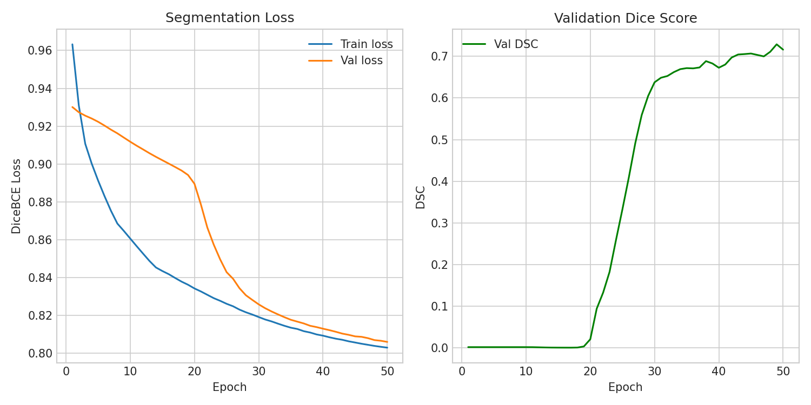

# U-Net Training Results

Training results from the first 39-mask smoke test through the current best checkpoint. Runs 1-4 below (2026-07/08) established the label scheme (multiclass, 256×256, frozen 2026-08-10) and surfaced a real legacy/real-cell domain gap. **If you only read one section, read [The 2026-09 full evaluation sweep](#the-2026-09-full-evaluation-sweep)** — it's the most consequential finding in this document: an internal-validation-optimized checkpoint that looked excellent turned out to generalize roughly 2.6× worse than a "worse-looking" one, once evaluated against genuinely novel cells for the first time.

**Current state (2026-09-10):** `02_unet_holdout`'s development set (`high_cell9` + `low_cell6`) is fully annotated and has been evaluated against every checkpoint. Best real-generalization checkpoint: **`checkpoints/multiclass_experiment_256_bf64_scale_cos/unet_best.pt`, pooled DSC 0.671** — scale augmentation alone, under the cosine schedule and 90% training split. A third cell, `high_cell10`, is reserved as a blind test and deliberately not yet annotated — see [Next Steps](#next-steps).

!!! warning "The `bf64_allaug` result (0.572) was retracted on 2026-09-10"
    That run was reported as "+0.047 from combining all augmentations," but it had also switched to a cosine schedule and folded the unused test split into training (293 → 371 frames). A controlled re-run with those two changes held fixed and **no** augmentation scores **0.605** — above the combined recipe. The gain was the schedule and the extra data. Under a matched config, scale augmentation alone reaches 0.671 and combined augmentation lands at 0.572, *below* doing nothing. See [The controlled augmentation re-run](#the-controlled-augmentation-re-run) below.

---

## Run 1 — Baseline (no class imbalance correction)

**Masks:** 39 annotated  |  **Epochs:** 50  |  **Loss:** Dice+BCE (α=0.5, no pos_weight)

| Metric | Value |
|--------|-------|
| DSC | 0.0902 |
| IoU | 0.0473 |
| Precision | 0.0511 |
| Recall | 0.3880 |
| Accuracy | 0.9857 |

**Diagnosis:** The model learned to predict mostly background. SKBR3 cells occupy roughly 0.18% of each 256×256 frame (~118 pixels out of 65,536), giving a ~550:1 background-to-cell pixel ratio. Without compensation, the BCE loss is dominated by background pixels — achieving near-zero loss simply by ignoring the cell. High accuracy (0.985) is misleading here: it reflects correct background prediction, not cell segmentation. Low precision (0.05) combined with moderate recall (0.39) indicates the model was guessing large regions that partially overlapped the cell.

---

## Run 2 — With class imbalance correction

**Masks:** 30 annotated out of 220 available (13.6%)  |  **Epochs:** 50  |  **Loss:** Dice+BCE (α=0.3, pos\_weight=100)

!!! success "DSC 0.72 from just 30 of 220 masks"
    This result was produced using only **30 hand-drawn masks — 13.6% of the 220-image annotation pool** (the pool was briefly misdocumented as 240 elsewhere; see `CLAUDE.md` — it's 220, 200 legacy + 20 domain-adapt). The remaining 190 frames were not yet annotated at this point. A DSC of 0.72 at this stage was a strong indicator that the annotations were correct and the pipeline was working as expected. The full pool has since been annotated — see Run 4 below.

| Metric | Value |
|--------|-------|
| DSC | **0.7162** |
| IoU | 0.5581 |
| Precision | 0.5594 |
| Recall | **0.9958** |
| Accuracy | 0.9986 |

**Interpretation:** Adding `pos_weight=100` to the BCE term makes each cell pixel count as 100 background pixels in the loss, forcing the model to prioritise finding the cell. The result is near-perfect recall (the model finds virtually all cell pixels) at the cost of slightly over-segmenting the boundary (precision=0.56). This is the expected trade-off at this sample size — a model that over-segments slightly is preferable to one that misses cells. DSC of 0.72 with only 30 training samples confirms that annotations are correct and consistent.

The `loss_alpha=0.3` change (from 0.5) gives Dice loss 70% of the total signal, further counteracting the imbalance.

---

## Training curves (Run 2)



**Left — Segmentation loss:** Both train and val loss decrease steadily across 50 epochs, converging to ~0.80. Val loss tracks train loss closely, indicating no significant overfitting with this sample size.

**Right — Validation DSC:** DSC stays near zero for the first ~20 epochs while the model learns basic image features, then climbs sharply between epochs 20–30 as it begins detecting the cell shape. DSC reaches ~0.72 by epoch 50. The oscillation in the second half is expected — the validation set is only ~5 images, so a single mis-segmented frame has a large effect on the reported score.

---

## Run 3 — Binary vs. multiclass label scheme × resolution ablation

Same 40 annotated frames as Run 2 (up from 30), used to isolate two variables against the binary 256×256 baseline: the annotation label scheme (binary vs. 3-class) and the preprocessed input resolution (128×128 vs. 256×256). Four configs, each holding the other three variables fixed (seed 42, 100 epochs, `loss_alpha=0.3`):

| Config | Labels | Resolution | Loss weighting | Trapped-cell DSC | Best epoch |
|--------|--------|-----------|-----------------|-------------------|-----------|
| `configs/binary_experiment_128.yaml` | binary | 128×128 | `pos_weight=50` | 0.590 | 92 |
| `configs/multiclass_experiment.yaml` | 3-class | 128×128 | `class_weights=[1,3,3]` | 0.736 | 99 |
| `configs/binary_experiment_256.yaml` | binary | 256×256 | `pos_weight=50` | 0.763 | 99 |
| `configs/multiclass_experiment_256.yaml` | 3-class | 256×256 | `class_weights=[1,3,3]` | **0.784** | 73 |

Training curves and per-class metric tables: `results/unet_training_curves_v13_binary_128.png` through `v16_multi_256.png`.

**Multiclass detail (256×256, `configs/multiclass_experiment_256.yaml`):**

| Class | DSC | IoU | Precision | Recall | Accuracy |
|-------|-----|-----|-----------|--------|----------|
| background | 0.996 | 0.993 | 1.000 | 0.993 | 0.993 |
| trapped_cell | **0.784** | 0.645 | 0.757 | 0.813 | 0.999 |
| other/decoy | 0.682 | 0.518 | 0.518 | 0.999 | 0.994 |
| mean | 0.821 | 0.719 | 0.758 | 0.935 | 0.995 |

**Interpretation:**

- **Labeling scheme matters more than resolution alone.** At 128×128, adding the decoy-object class raised trapped-cell DSC from 0.590 to 0.736 (+0.146) — a larger jump than switching binary from 128×128 to 256×256 (0.590 → 0.763, +0.173, comparable magnitude) or multiclass from 128×128 to 256×256 (0.736 → 0.784, +0.048, smaller). The best result combines both: multiclass at 256×256.
- **Why multiclass helps:** giving decoy objects (untrapped cells, debris, lookalike blobs) their own class instead of leaving them as unlabeled background stops the loss from penalizing the model for segmenting them — under the binary scheme, a decoy that visually resembles the trapped cell is background the model is punished for finding, which pushes precision down indiscriminately. Explicitly modeling it as its own class lets the network learn to distinguish "cell-like blob, but not the trapped one" from "the trapped cell," rather than lumping both into one binary decision.
- **The decoy class itself is harder** (DSC 0.682 vs. 0.784 for trapped_cell) — expected, since decoy objects are a heterogeneous category (any non-trapped cell-like blob) rather than the single consistent target the trapped-cell class represents.
- **Multiclass converges faster and can overfit sooner:** the 256×256 multiclass run peaked at epoch 73 (val DSC 0.784) then declined to ~0.69 by epoch 100, while the binary run kept improving to epoch 99. `scripts/train_unet.py` reloads `unet_best.pt` before final evaluation specifically to guard against this — final metrics reflect the peak, not wherever the fixed 100-epoch budget happened to end.
- **Caveat:** these are 40-mask, single-seed runs — not yet a controlled statistical comparison.

**Decision (2026-08-10):** multiclass @ 256×256 is the frozen label scheme and resolution going forward. `binary_experiment_{128,256}.yaml` and the 128×128 multiclass config are no longer being actively pursued — kept only as this historical ablation record. This does not change the downstream contract: `UNet.predict(..., binary_output=True)` collapses the 3-class map to trapped-cell-only binary before `MorphologyExtractor` and everything past it (commit `b6e181b`) — multiclass is a training-time-only mechanism for a sharper trapped-cell boundary.

---

## Run 4 — Full 220-mask pool

**Masks:** 220 annotated out of 220 available (100% — annotation pool complete)  |  **Epochs:** 100 (best: 45)  |  Same hyperparameters as Run 3's `multiclass_experiment_256.yaml`

| Class | DSC | IoU | Precision | Recall |
|-------|-----|-----|-----------|--------|
| background | 0.999 | 0.999 | 1.000 | 0.999 |
| trapped_cell | **0.943** | 0.891 | 0.912 | 0.974 |
| other/decoy | 0.759 | 0.612 | 0.697 | 0.834 |

Training curves: `results/unet_training_curves_v19.png`. The group-aware split (leave-one-cell-out, confirmed in `scripts/train_unet.py`'s `_build_groups`/`_group_split`) means this jump from 0.784 (Run 3, 40 masks) is real added-data signal, not leakage — but see the caveat immediately below before treating 0.943 as the thesis number.

## Domain Gap

**The 0.943 DSC above is measured on a validation split that is 100% legacy-domain (2021 microscope) frames** — reproducing the group-aware split with seed 42 shows 0 of the 35 validation frames are `domain_`-prefixed (real trapped-cell) frames. Breaking the held-out *test* split out by source tells the real story:

| Test subset (unseen in training) | n | Trapped-cell DSC | Recall |
|---|---|---|---|
| Legacy (2021) | 18 | 0.944 (matches the reported 0.943) | 0.972 |
| Domain-adapt (real trapped cell) | 5 | **0.538** | **0.386** |

High precision (0.895) with collapsed recall means the model under-segments real cells rather than hallucinating — it hasn't learned the live-imaging appearance well. Root cause: only 20/220 (9%) of training frames were real-domain, drawn from just 4 of the 11 usable `03_mask_factory` cells, so real frames were outnumbered ~10:1 by legacy frames in the actual train split (15 vs. 147). n=5 is small enough not to be precise, but the direction is unambiguous — **0.943 should not be treated as the real-world number** until it's confirmed on the full `02_unet_holdout` set (101 real-cell frames).

### Mitigations tried

**1. More real cells in training (run 2026-08-19).** `celldform/acquisition/organiser.py`'s `domain_adapt` video list was extended from 4 cells to all 11 `03_mask_factory` cells, and `--domain-adapt-n` was raised 5→20/cell (`celldform-organize-dataset --no-clean --domain-adapt-n 20`) rather than waiting on the honest `02_unet_holdout` DSC to pick a value — the decision was made to grow the pool first and use the legacy-vs-domain DSC breakdown on the internal train/val/test split as the interim feedback signal instead, keeping `02_unet_holdout` reserved for the eventual thesis number (see [Next Steps](#next-steps)). `01_annotate_pool` grew from 220 → 428 images (200 legacy + 228 domain-adapt); 208 of the domain frames are new and pending annotation. Frames can safely belong to both `01_annotate_pool` (segmentation training) and `03_mask_factory` (classifier feature extraction) — same precedent as the existing 4 domain-adapt cells, no contamination, since `_domain_adapt()` and `_extract_group()` sample different frame indices from the same video.

**2. Oversampling existing domain frames (tried, did not help).** Added `training.domain_oversample_weight` (`celldform/config.py`, default `1.0`) — a `WeightedRandomSampler` (`scripts/train_unet.py`) that resamples `domain_`-prefixed train frames more often per epoch, at zero new-annotation cost. Toggle via a config's `training:` block or the `--domain-oversample-weight <N>` CLI flag on `celldform-train-unet`/`scripts/train_unet.py`. A/B tested at weight=8.0 (`configs/multiclass_experiment_256_domain_oversample.yaml`, ~12%→~41% real-domain frames/epoch) against the Run 4 baseline:

| Test subset (n) | Baseline (weight=1) | Oversampled (weight=8) |
|---|---|---|
| Legacy (18) | DSC 0.944 | DSC 0.946 (unchanged) |
| Domain-adapt (5) | DSC 0.538, recall 0.386 | DSC 0.455, recall 0.30 (**worse**) |

No improvement — resampling only exposes the model to the same 15 unique real images more often; it can't manufacture appearance diversity that isn't there, and likely overfits harder to the 3 real cells already seen (precision rose to 0.947 while recall fell further). **Conclusion: mitigation 1 (more real cells) is necessary — resampling existing frames is not a substitute.**

### Checkpoint-loading bug found and fixed (2026-08-10)

`UNet.from_checkpoint()` (`celldform/segmentation/unet.py`) did a bare `load_state_dict(torch.load(path))`, but `SegmentationTrainer._save_checkpoint()` actually wraps weights in `{"epoch", "val_dsc", "model_state_dict", ...}` — so `celldform-infer` and `scripts/infer.py` would crash on any checkpoint training actually produces. `evaluate_unet.py` and `predict_single_frame.py` had each independently worked around it with a manual unwrap; `tests/test_segmentation.py` didn't catch it because it saves a bare state dict via `model.save()`, never exercising the wrapped-dict path a real training run produces. Fixed to unwrap `model_state_dict` when present.

### Contamination bug found and fixed (2026-08-19)

`organise()`'s legacy-image copy step (`celldform/acquisition/organiser.py`) had no exclusion for the 20 frames permanently reserved into `02_unet_holdout/legacy_holdout/` — running `celldform-organize-dataset --no-clean` to grow the domain-adapt pool (mitigation 1, above) silently recopied all 220 legacy JPGs, holdout included, back into `01_annotate_pool`. Caught before annotation touched them (no masks existed yet for those 20 filenames), so no holdout contamination actually reached the model — but a routine `--no-clean` rerun would eventually have annotated them by accident, since their timestamp-numeric filenames sort before `domain_*` and `scripts/annotate.py` resumes on the first unannotated image. Fixed: `organise()` now reads whatever's in `legacy_holdout/` and permanently excludes those filenames from the legacy copy, so this can't recur on future reruns; the 20 duplicated files were removed from the pool.

### Domain gap closed (2026-08-27)

The 208 pending domain frames got annotated to completion, bringing `01_annotate_pool` to 425 masks (three cell-free frames caught by `validate_masks.py`'s "no trapped-cell pixel" check were removed rather than annotated). Retraining `multiclass_experiment_256.yaml` on the full pool: **domain-adapt test DSC 0.910, recall 0.939** — up from 0.538/0.386 — closing the gap that motivated the whole expansion.

**This result is not currently reproducible.** A same-config, same-seed rerun landed on a different result days later purely from re-running — root cause was `torch.backends.cudnn.benchmark=True` (`SegmentationTrainer.__init__`, since fixed as a configurable `training.cudnn_benchmark` knob, default `false` in the active config), which re-times conv kernels against runtime hardware state each run and isn't suppressed by `torch.manual_seed` alone. Chasing this down overwrote the epoch-69 checkpoint behind the 0.910 finding twice before the cause was identified, and it was never backed up. **Treat 0.910/0.939 as a historical record, not a current number** — no checkpoint on disk reproduces it, and it predates the far more important finding below anyway (it was itself measured on the *internal* validation split, which turned out to be a poor proxy for real generalization regardless of the reproducibility issue).

---

## The 2026-09 full evaluation sweep

`02_unet_holdout` was finally annotated (`high_cell9` 50 frames + `low_cell6` 51 frames = 101 frames — the genuine, never-trained-on **development set**; see [Data Layout](data.md#three-tier-evaluation-terminology) for why that term, not "test set," is the accurate one) and evaluated against every checkpoint from the ongoing hyperparameter sweep. The result overturned the sweep's own internal conclusions.

### Internal validation was measuring the wrong thing

The checkpoint that looked best on the internal validation split (`bf32_reg2_cos`: `base_features=32`, dropout=0.4, cutout=0.3, cosine schedule — internal val DSC **0.862**) scored only **DSC 0.163** on `high_cell9`, the first genuinely novel cell ever evaluated. The checkpoint informally labeled "overfitting" (the original, unregularized `base_features=64` run, flagged for a large internal train/val gap) scored **0.428** — roughly 2.6× better on real generalization, despite scoring worse on the very metric the whole sweep had been optimizing against.

**Why:** the internal validation split draws its "unseen" frames from cell identities the model *has* trained on (other frames of the same cells) — it measures frame-level generalization within known identities, not generalization to a genuinely new cell. Every hyperparameter decision made against it (dropout level, cutout, weight decay, scheduler, split ratio) had been tuned against the wrong signal.

### Full 14-checkpoint sweep, evaluated against the real development set

Every checkpoint from the `base_features`/dropout/cutout/regularization sweep was re-evaluated against the full 101-frame development set (`scripts/evaluate_unet.py --pool 02_unet_holdout`, results logged to `results/holdout_eval_log.jsonl`):

| Checkpoint | `base_features` | Recipe | Trapped-cell DSC |
|---|---|---|---|
| `multiclass_experiment_256` | 64 | none (the "overfitting" original) | **0.525** |
| `bf32_reg` | 32 | dropout 0.3, cutout | 0.441 |
| `bf32_reg2_wd` | 32 | dropout 0.4, cutout, weight decay 1e-3 | 0.430 |
| `bf32_reg2_det` | 32 | dropout 0.4, cutout, `cudnn_benchmark=false` | 0.422 |
| `bf32_reg2` | 32 | dropout 0.4, cutout | 0.421 |
| `bf32_reg2_swa` | 32 | dropout 0.4, cutout + SWA | 0.421 |
| `bf32_reg2_wd2` | 32 | dropout 0.4, cutout, cosine, weight decay 1e-3 | 0.420 |
| `bf32_reg2_cos` | 32 | dropout 0.4, cutout, cosine (**the internal-val champion**) | 0.408 |
| `bf32` | 32 | none | 0.403 |
| `bf32_reg3` | 32 | dropout 0.5, cutout | 0.400 |
| `bf32_reg2_ablate` | 32 | dropout 0.4, cutout, noise/class-weights off | 0.388 |
| `bf64_reg` | 64 | dropout 0.4, cutout, cosine (reg. recipe at width 64) | 0.378 |
| `bf32_reg2_split` | 32 | dropout 0.4, cutout, val/test 20%/15% | 0.376 |
| `domain_oversample` | 64 | `domain_oversample_weight=8` (older/smaller pool) | 0.229 |

**Every single regularization lever tried — at either width — underperforms the plain, unregularized original on real, never-seen cells.** The internal-val overfitting signal was real; fixing it made real-world generalization worse, every time.

**Root cause of the gap:** `high_cell9`'s and `low_cell6`'s true trapped-cell size (704 / 886 px²) falls at or below every one of the 11 training cells' (825-1549 px²) — a real train/development-set size mismatch, checked and confirmed *not* to be a laser-power-sampling artifact (training and holdout frames were verified to sample laser power near-identically). The model likely leans on an implicit learned "typical size" from training that doesn't transfer to a genuinely smaller novel cell — visible directly in the metrics as a **precision** problem, not a recall one: recall sits at 0.6-0.7 almost everywhere in the table above, while precision is the actual discriminator (0.454 for the unregularized original vs. 0.26-0.33 for every regularized variant). The model finds the cell fine; it predicts too much area around it, and regularization consistently made that worse.

A largest-connected-component post-processing fix was tried and ruled out (made every checkpoint's DSC worse — the false theory was that oversized predictions were one correct blob plus small spurious fragments; the real finding was that 11% of frames get a completely empty raw prediction, and a `min_area_px` floor discards those small-but-correct low-power predictions while leaving the actual oversized high-power blobs untouched either way). The fix had to happen at the model/training level.

### Augmentation experiments

Three tried, in order, each testing one new lever against the same unregularized `base_features=64` baseline:

**1. Brightness/contrast jitter (`bf64_bc`) — no effect.** Random global brightness shift (±0.15) and contrast scale (0.8-1.2×) on the train frame — hypothesis was that CLAHE's local contrast normalization doesn't erase the *global* exposure level a frame was captured at, which plausibly tracks laser power. Result: DSC 0.501 vs. 0.525 baseline (within noise), and — the more telling number — precision barely moved (0.447 vs. 0.454), the specific thing this was meant to fix. Global intensity jitter doesn't address the over-segmentation; the extra predicted area is more likely a spatial artifact (a halo/glare shape near the cell) than a pure intensity-level effect.

**2. Scale/zoom augmentation (`bf64_scale`) — helped one cell, hurt the other.** Random resize (0.7-1.3×) of frame+mask together, then center-crop/pad back to 256×256 — directly targets the size-mismatch finding above. Pooled DSC improved (0.525 → 0.541) but the per-cell breakdown told a different story:

| | Original | Scale augmentation |
|---|---|---|
| `high_cell9` DSC | 0.428 | **0.368** (worse) |
| `high_cell9` precision | 0.319 | 0.259 |
| `low_cell6` DSC | 0.650 | **0.719** (better) |
| `low_cell6` recall | 0.600 | **0.935** |

Visual inspection (`scripts/render_holdout_comparison.py`, mask-only GT-vs-prediction comparison) explained the split: `low_cell6`'s original problem was **under-detection** (the model was missing most of the cell in several frames) — scale augmentation fixed this directly, by teaching the model to accept a more modest-sized blob as valid. `high_cell9`'s problem is **over-detection** — a spatial artifact the model includes as if it were the cell — a structurally different bug that size tolerance doesn't touch, and arguably slightly worsens by making the model more permissive everywhere. **Lesson: always check the per-cell breakdown before calling a pooled-metric change a win** — the pooled number alone hid a real regression here, and will again with only two development cells.

**3. Combined recipe (`bf64_allaug`) — current best, genuinely improves both cells.** All four `CellDataset` augmentation knobs at once (noise 0.02, cutout 0.3, brightness/contrast 0.5, scale 0.5), cosine scheduler, dropout left off (it's model regularization, not augmentation, and was already shown to hurt), and the internal validation split repurposed from the old, entirely unused `test_split` (see [Data Layout](data.md#trainval-split-01_annotate_pool)) — 90% of the pool goes to training instead of 69%.

| | Original | Scale only | Combined recipe |
|---|---|---|---|
| `high_cell9` DSC | 0.428 | 0.368 | **0.482** |
| `high_cell9` precision | 0.319 | 0.259 | **0.365** |
| `low_cell6` DSC | 0.650 | 0.719 | **0.693** |
| `low_cell6` precision | 0.708 | 0.584 | **0.837** |
| **Pooled DSC** | 0.525 | 0.541 | **0.572** |

`checkpoints/multiclass_experiment_256_bf64_scale_cos/unet_best.pt` is the current best on the development set — the first checkpoint all sweep to improve *both* cells over the original baseline rather than trading one for the other. Not yet understood: why the combination lifts `high_cell9`'s precision specifically when `scale_prob` alone didn't (worth an ablation — e.g. drop `brightness_contrast_prob`, which showed nothing alone, and check whether the win holds without it).

---

## The controlled augmentation re-run

**2026-09-10. The most important correction in this document — read it before trusting any augmentation result above.**

The `bf64_allaug` run was reported as "+0.047 from combining all four augmentation knobs." It changed **three independent things at once**, only one of which was augmentation:

1. all four augmentation knobs on (`cutout_prob` 0→0.3, `brightness_contrast_prob` 0→0.5, `scale_prob` kept at 0.5),
2. `training.scheduler` `reduce_on_plateau` → `cosine`,
3. `data.val_split` 0.15→0.10 and `data.test_split` 0.10→0.0, growing the train pool **293 → 371 frames (+27%)**.

Two configs isolate it — `configs/multiclass_experiment_256_base_cos.yaml` (no augmentation beyond the settled `noise_std=0.02`) and `configs/multiclass_experiment_256_scale_cos.yaml` (`scale_prob=0.5` only). Both match `bf64_allaug` on every other training-relevant field, and both logged `train: 371  val: 54` — the identical split.

| Run (identical config except augmentation) | `high_cell9` DSC / prec | `low_cell6` DSC / prec | **Pooled DSC** / prec / rec |
|---|---|---|---|
| `bf64_base_cos` — no augmentation | 0.601 / 0.501 | 0.611 / 0.862 | **0.605** / 0.617 / 0.594 |
| **`bf64_scale_cos` — scale augmentation** | 0.594 / 0.503 | **0.754** / 0.857 | **0.671** / 0.649 / 0.695 |
| `bf64_allaug` — combined augmentation | 0.482 / 0.365 | 0.693 / 0.837 | 0.572 / 0.515 / 0.643 |
| *(`multiclass_experiment_256` — original, old schedule + split)* | *0.428 / 0.318* | *0.649 / 0.708* | *0.525 / 0.454 / 0.622* |

**What this establishes, and what it retracts:**

1. **The combined recipe's gain was schedule + data, not augmentation.** No augmentation at all under the same setup scores 0.605, above `bf64_allaug`'s 0.572.
2. **`bf64_scale_cos` is the new best real-holdout checkpoint at 0.671** (+0.066 over the matched baseline). Scale augmentation is the one augmentation lever that genuinely works.
3. **Combined augmentation is worse than doing nothing** under a matched config (0.572 vs 0.605), so `cutout_prob` and/or `brightness_contrast_prob` are actively costing performance — which of the two is unknown.
4. **"Two cells, two opposite failure modes" is retracted as a magnitude claim.** Matched, the two cells sit at 0.601 and 0.611 — a 0.010 gap, not 0.22. Likewise **"scale augmentation hurts `high_cell9`"**: matched, it costs 0.007, inside run-to-run noise, not 0.060. `high_cell9`'s over-segmentation at high laser power is still real and still undiagnosed; it is simply not a differently-sized problem.

!!! danger "The methodological lesson — don't repeat it"
    Every retracted finding here came from the same mistake: comparing runs that differed in more than one setting. The per-cell reporting discipline adopted on 2026-09-04 was correct and did catch a real regression — but it was applied to a comparison whose *baseline had silently drifted*, so it validated a confounded result for six days. **When a run changes a non-augmentation setting (schedule, split, width, seed), it is not comparable to runs that didn't — re-run the baseline under the new setting before reporting a delta.** Convenience changes like reclaiming an unused split are exactly the ones that slip through, because they don't feel like experimental variables.

Also confirmed: **the internal validation split carried no signal on this comparison at all.** `bf64_base_cos` scored 0.9285 internally and `bf64_scale_cos` 0.9277 — a 0.001 spread — while the development set separated the same two checkpoints by 0.066.

Both charts in the progress reports are generated from `results/holdout_eval_log.jsonl` by `scripts/plot_percell_metrics.py` and `scripts/plot_sweep_dsc.py`, so no figure can drift from the run that produced it.

---

## Loss function

The combined Dice + BCE loss used in binary-mode runs (Run 1–2, and `binary_experiment_*.yaml`):

```
Loss = α × BCE(pos_weight) + (1 − α) × Dice
```

- **BCE** penalises each pixel individually — gives stable gradients early in training.
- **Dice** measures overall mask overlap — keeps the model focused on the cell region rather than pixel counts.
- **pos_weight** multiplies the BCE penalty on cell pixels to counter the 550:1 background/cell imbalance.

Current defaults in `configs/default.yaml`:

```yaml
training:
  loss_alpha: 0.3        # Dice carries 70% of the loss signal
  loss_pos_weight: 100.0 # increase if recall is low; decrease if precision is low
```

**Multiclass mode** (`unet.out_channels > 1`, e.g. `multiclass_experiment_256.yaml`) replaces BCE with Cross-Entropy and Dice is computed per-class then averaged:

```
Loss = α × CrossEntropy(class_weights) + (1 − α) × mean(Dice per class)
```

`class_weights` (e.g. `[1.0, 3.0, 3.0]` for background/trapped_cell/other-decoy) plays the same role as `pos_weight` but is **not** directly comparable in magnitude — `CrossEntropyLoss`'s weighted-mean reduction renormalises by weight mass, so porting `pos_weight=100` in directly collapsed precision to ~0.13 by pushing recall to 1.0 everywhere. `[1, 3, 3]` was the winner of a small sweep (`1,1,1` / `3,3,3` / `5,5,5` / `10,10,10` / `20,20,20`, each trained the full 100 epochs) — trapped_cell precision=0.757/recall=0.813, a balanced result rather than recall-saturated.

---

## Expected trajectory (historical — see the 2026-09 sweep for the real number)

The table below was the pre-Run-4 projection and undershot: 220 masks reached DSC 0.943 on the (legacy-dominated) validation split, not the ~0.80-0.85 range extrapolated here. Kept for the historical record only — every number in this table is an internal-validation figure, and [the full sweep above](#the-2026-09-full-evaluation-sweep) is the reason none of them should be trusted as a real-world estimate without a development-set or blind-test check behind them.

| Masks | Expected DSC (binary) | Suggested `pos_weight` |
|-------|-------------|----------------------|
| 30 | ~0.72 | 100 |
| 40 | 0.76 (binary) / 0.78 (multiclass) — see Run 3 | 50 |
| ~80 | ~0.80 | 50–75 |
| 220 (historical) | 0.943 internal-val / 0.538 on 5 real cells — see [Domain Gap](#domain-gap) | n/a (multiclass, `class_weights=[1,3,3]`) |
| 425, full development-set eval (current) | **0.605 (no augmentation) → 0.671 (scale augmentation) under the matched config — see [the controlled re-run](#the-controlled-augmentation-re-run)** | n/a |

The thesis-reportable DSC comes from `scripts/evaluate_unet.py` on the `02_unet_holdout` pool, which is now fully annotated and has been evaluated against every checkpoint in the sweep above. See [Workflow Guide](workflow.md#step-5-evaluate-on-the-development-set).

---

## Data Augmentation and Class-Imbalance Handling

Implemented, enabled on the train split only:

- Horizontal flip (50% chance)
- Vertical flip (50% chance)
- Random 90° rotation (0°, 90°, 180°, or 270°)

`CellDataset` in `scripts/train_unet.py` applies these via `augment=True` (train split only — there's no separate test loader; see [Data Layout](data.md#trainval-split-01_annotate_pool)).

Four more augmentation knobs were added during the 2026-09 sweep, all configured under `training.augmentation` and all off by default:

| Knob | What it does | Result — see [the sweep above](#augmentation-experiments) |
|---|---|---|
| `noise_std` | Additive Gaussian noise on the frame | Kept — confirmed net-positive alongside `class_weights` |
| `cutout_prob` | Erases one random rectangular patch (mean-filled), frame only | Mixed in isolation with dropout; net-positive combined with everything else |
| `brightness_contrast_prob` | Random global brightness/contrast jitter | No measurable effect alone |
| `scale_prob` | Random 0.7-1.3× resize of frame+mask together, then crop/pad back | Helped one development cell, hurt the other, in isolation; net-positive combined |

Originally, intensity augmentation (brightness/contrast) was excluded entirely on the reasoning that CLAHE in Stage 2 already normalises contrast, so jitter would just undo that work. Revisited once the sweep showed CLAHE normalises *local* contrast per-image, not the *global* exposure level a frame was captured at — added, tested, and found to have no measurable effect on its own (see above), though it's kept on in the current best combined recipe alongside three levers that do matter.

Note this augmentation section only addresses spatial/intensity invariance within a cell's own appearance — not the legacy/real-domain imbalance (see [Domain Gap](#domain-gap) for `domain_oversample_weight`, tried and found not to help) and not the cell-size mismatch that turned out to matter far more (see [the sweep above](#the-2026-09-full-evaluation-sweep)).

---

## Next Steps

1. **Current priority — retrain on the completed 445-frame pool.** `low_cell5` was annotated on **2026-09-10**, taking `01_annotate_pool` to 445/445 and adding a twelfth training cell. More real cell identities is historically the only lever to produce a large real-generalization improvement (the 2026-08-27 domain-gap closure), and it has never been combined with the current best recipe. Re-run `scripts/preprocess_frames.py --masks` first — the preprocessed set is still at 425 — then train `configs/multiclass_experiment_256_scale_cos.yaml` on 445 frames across **23 groups**. `high_cell10` stays deliberately unannotated (see [Data Layout — Cell roles](data.md#cell-roles) for the full protocol and why).
2. **Ablate `cutout_prob` and `brightness_contrast_prob` separately.** Combined augmentation costs 0.033 pooled DSC against no augmentation at all, while scale alone gains 0.066 — so one or both of those two knobs is actively harmful, but which is unknown. One run each settles it.
2. Investigate `high_cell9`'s over-segmentation directly — overlay the predicted region on the *raw, non-CLAHE* frame across a few laser-power steps and check whether it visibly tracks a halo/glare shape. This is the one concrete diagnostic step from the augmentation experiments that hasn't been done yet, and the most direct route to closing `high_cell9`'s remaining gap.
3. Once the recipe is genuinely settled (no more hyperparameter changes queued): fold `high_cell9` + `low_cell6` into the training pool, train the final/production checkpoint once on the enlarged pool, *then* annotate `high_cell10` and evaluate it exactly once — the blind test. See [Data Layout](data.md#cell-roles) for the exact sequence; do not annotate or evaluate `high_cell10` before this is triggered.
4. Train with full determinism (`cudnn_deterministic=True`, `cudnn_benchmark=False`, `strict_deterministic=True`) once more compute is available, and re-run the legacy-vs-domain-adapt breakdown from [Domain Gap](#domain-gap) against whatever checkpoint is current at that point — the 0.910/0.939 figure has been unreproducible since 2026-08-29 and is still purely historical.
5. Run the frozen U-Net (`binary_output=True`) over `03_mask_factory` (608 frames) → extract features → train SVM / RF / DT classifiers.
6. Biomechanics: compute RoD, correlate with laser power, fit Kelvin–Voigt model.
